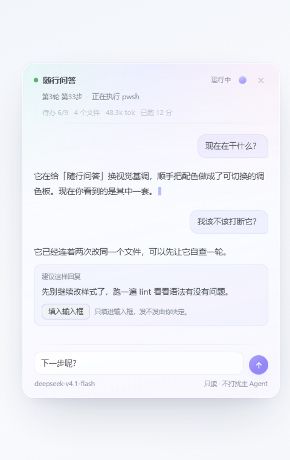
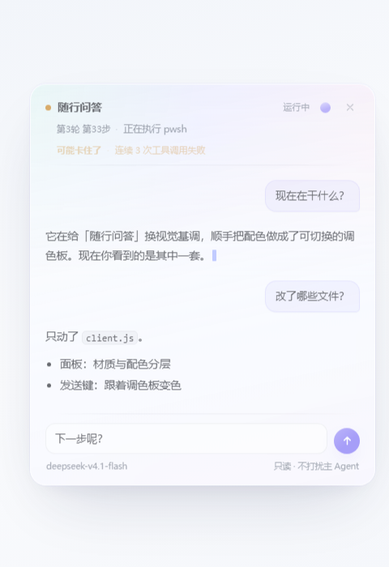
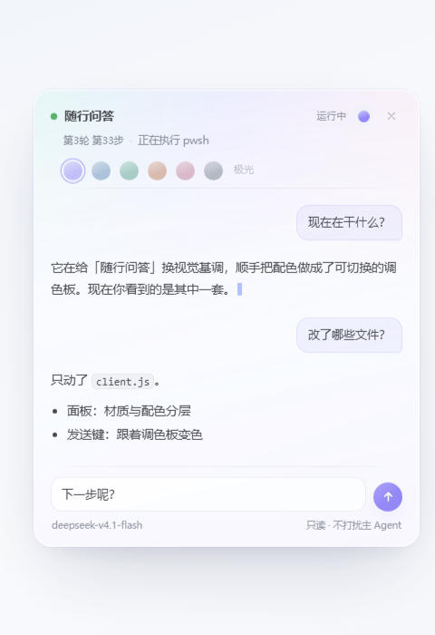
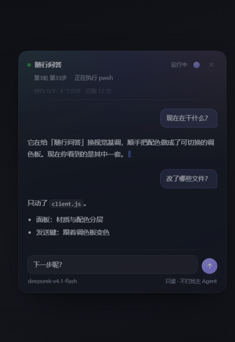

# 会话随行问答 · Session Companion

会话正在跑长任务的时候，主 Agent 忙得没法回话，而它的思考链还基本是英文——你既不知道它现在在干嘛，也没法打断它。

这个插件在输入框左侧加了一个「随行」入口。点开是一块浮动小窗，你可以直接问：

- 现在在干什么？
- 卡在哪一步了？
- 它在想什么？说人话
- 到现在改了哪些文件？

回答来自**另一次独立的模型调用**：它只读当前会话的日志，没有任何工具，不会写会话、不会唤醒主 Agent、不会改变正在跑的任何东西。

## 截图

| 问答 + 建议卡片 | 进度带 |
| --- | --- |
|  |  |

| 材质选择 | 深色 |
| --- | --- |
|  |  |

## 安装

这是一个 DSH 插件包（`dsh.bundle.patch` + `dsh.client`），不是 npm 库。

```bash
git clone https://github.com/neil-ji/dsh-session-companion.git
```

然后在 DSH 里用插件管理把**这个目录**作为 bundle 安装（`plugin_manager` 的 `install_bundle`，target 传绝对路径），或在 Plugins 页面选择本地目录。安装后：

- 前端改动（面板、主题、快捷键）刷新页面即可；
- Host 改动（接口、system prompt）需要重启一次桌面端——DSH 不热重载已安装插件的 Host 代码。

## 界面

视觉基调是「轻」：一块半透明磨砂玻璃浮在界面右下角，不用实心灰底。

- 入口：输入框左侧的「随行」小按钮，绿点会在会话运行中脉动（同时有「运行中/空闲」文字，不靠颜色单独传达状态）。
- 面板：圆角 20，`backdrop-filter: blur(30px) saturate(1.75)`，淡蓝紫渐变底 + 顶部一层向下的品牌色微光；外层是 1px 高光内描边 + 一圈极淡的品牌色 ring。
- **高度随内容自适应**（`max-height: min(66vh, 612px)`）：内容少时不会留一大片空底色，内容多时才固定高度内部滚动。
- 标题行两层：第一行图标 + 标题 + 运行徽标 + 关闭；第二行「第 N 轮 第 M 步 · 当前动作」，分隔线用两端淡出的 hairline，不用整条实线。
- 用户消息：右对齐、品牌色淡染气泡；助手消息不加气泡，直接用正文排（13.5px / 1.82 行高），长段落更好读。
- 键盘：`Enter` 发送、`Shift+Enter` 换行、`Esc` 关闭；输入框自动增高（最高 116px）。
- 全局快捷键：**`Ctrl+Shift+/`** 随时开关面板（`event.code === 'Slash'`，与键盘布局无关，也不会被其它修饰键误触）。
- 切换会话自动关闭：面板挂在 root 层的 overlay 上，比会话活得久；所以会话一换，触发器就把面板关掉，正在流式中的那次请求也一并中止，不会把上个会话的内容留在新会话里。
- 滚动：默认贴底；往上翻会自动停住，并浮出「跳到最新」，不会把你拽回去。
- 空态：一段说明 + 四个常用问题（白色卡片，hover 上浮 1px）。
- 失败：内联错误卡片（`role="alert"`），带「重试」。
- 回答按 Markdown 渲染（粗体、代码、列表、引用、链接、代码块），流式过程中未闭合的标记按纯文本显示，不闪。
- 浅色/深色两套材质分别写死（`[data-ds-dark-theme]`），token 只负责文字与品牌色，保证深色下玻璃不会变成一块白板；`prefers-reduced-motion` 下关闭全部动效。

想单独看渲染效果，可以跑 `node test/preview.mjs`，它会用同一份样式表生成 `test/preview-{empty,chat,dark}.html`，直接丢给无头 Chrome 截图即可（`test/shot-*.png` 就是这么来的）。

回答长度由 Host 的 system prompt 约束：默认 3 句 / 100 字以内说完，只有你说「展开说」「详细点」才加长；`maxAnswerTokens` 默认 500 作为硬上限。

## 进度与卡住检测

面板标题下面多一行**进度带**，数据全部来自会话日志，不花模型调用：

```
第9轮 第43步 · 正在执行 pwsh
待办 6/9 · 4 个文件 · 已跑 12 分
```

| 字段 | 来源 |
| --- | --- |
| 待办 完成/总数 | 最近一次 `todo_write` 的参数（主 Agent 自己维护的清单） |
| 改动文件数 | `write` / `edit` / `multi_edit` / `apply_patch` 调用里出现过的 `file_path`，去重 |
| tok | `ctx.tokenMeter.measure()` 的上下文压力，最多每 15 秒采样一次（它是 O(surface) 的） |
| 已跑 | 当前 `turn/start` 到现在 |

会话看起来不对劲时，这一行换成琥珀色告警，状态点同时变色：

| 判定 | 触发条件 |
| --- | --- |
| `failing` | 连续 3 次工具调用失败 |
| `looping` | 最近 12 次调用里，同一「工具+参数」重复 ≥ 3 次 |
| `quiet` | 运行中，但超过 `stallMinutes`（默认 8 分钟）没有任何新事件 |

只在「运行中」判定——空闲会话不会被告警。命中告警时快照里会多一行 `[注意]`，所以直接问「它是不是卡住了」能拿到有依据的回答。

## 语气

面板右下角有个小开关：**说人话** ⇄ **技术细节**。

- 「说人话」是默认：3 句、100 字以内，全部翻成日常中文；
- 「技术细节」在 system prompt 末尾追加一段，允许点名工具、路径、命令、报错码，允许贴一两行关键代码，长度放宽到 200 字——但仍然禁止标题和套话；
- 选择存在 `localStorage`（`dsh-session-companion.tone`），每次请求带 `tone` 字段，切换即时生效、不需要重启。

## 按会话记忆

每个会话的问答线程分别保存在 `localStorage`（key `dsh-session-companion.threads.v1`，按 `sessionId` 分组）：

- 切走会话时会自动收进存储，切回来重新打开面板就能接着问；
- 每个线程只留最近 30 条、单条最多 2000 字，避免撑爆配额；
- 存储不可用（无痕模式、配额满）时只影响持久化，内存里的对话照常工作；
- **清空**：标题栏的垃圾桶按钮，点一下变成红色的「确认清空？」，再点一下才真的删；4 秒不点会自动退回。只清当前会话的线程，其它会话的记录不受影响；删到一条不剩时连 `localStorage` 的 key 一起移除。正在流式回答时按钮是禁用的，避免删到一半。

## 建议回复（只填不发）

随行可以在回答末尾用一个 ` ```reply ` 代码块给出一句可以直接发出去的话。面板把它渲染成一张「建议这样回复」卡片，带一个「填入输入框」按钮：

- 点一下，文字被写进主输入框——**在光标处插入**，不会覆盖你已经打的内容；
- **不会发送**，Enter 永远由你按；
- 填入成功后随行面板自动关闭，把输入框还给你；
- 插入被拒绝时退回整体替换（`setDraft`），再失败就在卡片上显示「填入失败」。

实现上，面板挂在 root 层，拿不到 `inputActions`，所以它只记录一个 `pendingDraft` 意图；真正执行的是会话作用域的触发器（`captureInsertion` → `insertText` → `persistDraft`）。这条通路保证了随行永远只碰草稿，不碰发送。

## 主题（材质）

材质与配色分成两层：`REFINED_CSS` 只负责几何与排版，`PALETTE_CSS` 是唯一决定颜色的地方。内置六套，都是"有色薄片"——浅色底 + 同色系强调色，深色模式各有一套配对：

| key | 名称 | 主色 | 感觉 |
| --- | --- | --- | --- |
| `mist` | 雾蓝 | 钢蓝 `#4a76a8` | 冷、干净、最像系统工具 |
| `celadon` | 青瓷 | 玉绿 `#3f8f7c` | 茶感，安静 |
| `paper` | 宣纸 | 陶土 `#b4653f` | 暖，有纸感 |
| `blush` | 藕粉 | 玫紫 `#b5637f` | 柔，偏女性向 |
| `glass` | 玻璃白 | 墨灰 `#5a6472` | 几乎无色，只剩玻璃质感 |
| `aurora` | 极光 | 靛紫 `#7b6cf6` | 白底 + 青→紫→粉的流动微光 |

默认是 **极光 `aurora`**。

切换方式：

1. 面板标题栏右侧的小圆点按钮（就是当前材质的颜色）——点开出现六个色点，点一个立刻切换并记住；
2. 选择存在 `localStorage`（key `dsh-session-companion.theme`），刷新后保持；
3. 改 `client.js` 顶部的 `const DEFAULT_THEME = 'aurora'` 换出厂默认；删掉那个 key 就回到默认。

新增一套只需要在 `PALETTE_CSS` 末尾加一个 `[data-palette="xxx"]` 块，定义 `--sc-accent`、`--sc-glass-1..3`、`--sc-wash`、`--sc-user`、`--sc-shadow*` 和对应的 `--sc-d-*` 深色值——其余颜色由 `color-mix` 从主色推导，不用重复写。

## 它到底读什么

Host 半边把会话日志整理成一份摘要再交给模型：

| 来源 | 内容 |
| --- | --- |
| `user/message` | 你提过的需求（截断） |
| `assistant/message` | 每一步的 `reasoning` 与最终文本 |
| `tool/call` | 工具名 + 参数（截断） |
| `tool/result` | 结果摘要、失败标记 |
| `turn/*`、`step/*` | 轮次与步骤骨架 |
| `agent/assistant-stream` | **正在生成、还没写进日志的思考与输出** |

最后一条是关键：只读日志的话，模型思考时日志里什么都不会动，问答就会显得"卡住"。实时流补上了这一段，所以问"现在在干嘛"能拿到此刻的想法。

## 保证不打扰主会话

- 只调用 `session.snapshotEvents()` 这类读接口，从不 `append`；
- 模型请求里**不带 `tools`**，因此不可能产生工具调用；
- 不调用 `agent.followup()` / `agent.inject()`，不排队、不插话；
- 路由头需要一个会话 id，但用的是合成 id（`session-companion-…`），不是你的真实会话 id——随行问答的 token 不会被算到主会话头上；
- 前端只在面板打开或入口挂载时轮询 `GET /session-companion/status`，6 秒一次，纯本地。

## 配置

装在 `cordis.patch.yml` 的插件行里：

```yaml
- insert:
    - id: session-companion
      name: '@local/dsh-session-companion'
      config:
        enabled: true
```

| 字段 | 默认 | 说明 |
| --- | --- | --- |
| `enabled` | `true` | 关掉后不注册路由，前端入口也不再出现 |
| `provider` / `model` | 空 | 留空则跟随**该会话正在用的模型**；两个都填才生效 |
| `historyEvents` | `60` | 摘要里保留的最大行数 |
| `digestChars` | `7000` | 摘要字符预算，超了从最旧的行开始丢 |
| `maxAnswerTokens` | `500` | 回答的硬上限；想让它更啰嗦可以调大 |
| `keepTurns` | `6` | 追问时带上的历史问答轮数 |
| `stallMinutes` | `8` | 「运行中但没动作」多久算卡住 |

## 接口

只挂在本机 Web 服务上，仅接受同源请求，请求体上限 96 KiB。

- `GET /session-companion/status?session=<id>` → `{ ok, running, phase, headline, model, progress }`；会话不在本进程时 `409 session-not-live`
- `POST /session-companion/ask` `{ sessionId, question, history, tone }` → SSE 事件流：`start` / `delta` / `done` / `error`

## 自测

```bash
node test/selftest.mjs   # 摘要渲染、预算裁剪、状态判定、实时流、进度/卡住、配置钳制
node test/markdown.mjs   # Markdown 解析：行内/列表/代码块/未闭合标记/XSS/reply 围栏
node test/threads.mjs    # 按会话记忆：裁剪、上限、往返、损坏数据、写入失败
node test/shortcut.mjs   # 全局快捷键判定 + 语气 prompt 分支
node test/preview.mjs    # 生成离屏预览页（配合无头 Chrome 截图）
```

`test/asar-extract.mjs <archive> <inner/path> <dest>` 可以从 `app.asar` 里抽出任意文件——当初就是靠它读到 `InputActions` 的真实接口的。

## 边界

- 会话必须**在当前 Host 进程里活着**才能读；重启后打开的旧会话、已归档会话的日志不在内存里，面板会给出提示。
- 摘要按字符预算截断，早期细节（比如第一轮的具体改动）可能不在快照中；问得越具体，答案越准。
- 它解释的是"日志显示它在做什么"，不是"它一定做对了"。判断对错仍然要靠你自己核对。
- Host 侧改动（system prompt、接口）**不热重载**：改完 `index.js` 必须重启桌面端。前端改动刷新页面即可。
